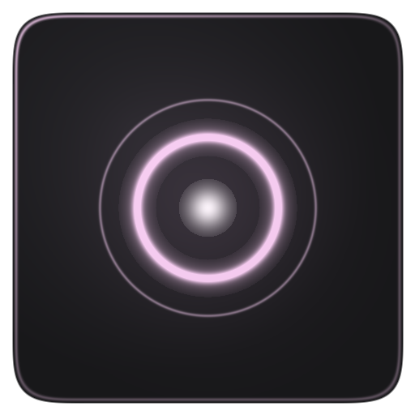

<div align="center">
  
  <h1>⚡ LUMINAR // Ocular Recovery & Deep Work HUD</h1>
  <p><strong>Gamified Neuro-Ocular Recovery Protocols, Dynamic Eye-Tracking Workouts, Draggable Stealth HUD & Circadian Blue-Light Shield for Chrome (Manifest V3)</strong></p>

  <p>
    
    
    
    
    
  </p>

  <h3>
    🎮 <a href="./docs/index.html">Play Interactive Web Arena</a>
    &nbsp;•&nbsp;
    📦 <a href="./docs/downloads/luminar-chrome-extension.zip">Download Chrome Extension (.ZIP)</a>
    &nbsp;•&nbsp;
    🛡️ <a href="./PRIVACY_POLICY.md">Privacy Policy</a>
  </h3>
</div>

---

## 🌌 Overview

**Luminar** combats digital eye strain and ciliary muscle spasm during deep-work sessions without breaking developer flow. Built on **Chrome Manifest V3**, **React 18**, **TypeScript**, and **Plasmo Shadow DOM CSUI**, Luminar pairs an ultra-clean draggable **Stealth HUD** with structured 60-second and 90-second biometric ocular workouts.

---

## ✨ Core Architecture & Features

| Module | Description |
| :--- | :--- |
| **🛸 Draggable Stealth HUD** | Shadow-DOM isolated (`plasmo-csui`) floating countdown orb with quick toggles for **Blue-Light Shield** and **Meeting Shield (F1)**. |
| **🎯 5 Guided Ocular Workouts** | **1. Distance Gaze** (18s horizon reset) → **2. Orb Pursuit** (horizontal smooth pursuit) / **3. Infinity Tracking** (Lissajous figure-8) / **4. Corner Tracking** (diagonal saccades) → **5. Blink Training** (20s tear-film restoration) + **90s Long Break** every 4th cycle. |
| **🛡️ Smart Auto-Meeting Shield** | Automatically detects `meet.google.com`, `zoom.us`, `teams.microsoft.com`, `webex.com`, and fullscreen mode to delay visual hijacks during live calls. |
| **☀️ Circadian Blue-Light Filter** | Document-start CSS multiply shader with 3 warmth presets (`Low` / `Mid` / `High`) synced across tabs in real time via `@plasmohq/storage`. |
| **🎮 Playable Cyber Arena (`/docs`)** | Standalone 60FPS interactive web experience with Web Audio synthesizer SFX, XP & Rank progression, combo multipliers, and a live 1:1 Extension Popup + Stealth HUD simulator. |

---

## 🚀 Quick Install (Chrome / Brave / Edge / Arc)

1. Download **[`luminar-chrome-extension.zip`](./docs/downloads/luminar-chrome-extension.zip)** (or build locally via `pnpm build && pnpm package`) and unzip it.
2. Open `chrome://extensions` in your browser and enable **Developer mode** (top right).
3. Click **Load unpacked** and select the extracted folder (`build/chrome-mv3-prod`).

---

## 🛠️ Local Development

```bash
# Install dependencies
pnpm install

# Start live-reloading development build
pnpm dev

# Build & package production Chrome Web Store bundle (build/chrome-mv3-prod.zip)
pnpm build && pnpm package
```

---

## 📄 License & Privacy

**100% Offline & Private:** Luminar uses zero external servers, zero analytics, and requests only `storage` and `alarms` permissions. See [PRIVACY_POLICY.md](./PRIVACY_POLICY.md) and [CHROME_WEB_STORE_KIT.md](./CHROME_WEB_STORE_KIT.md) for full store details.
